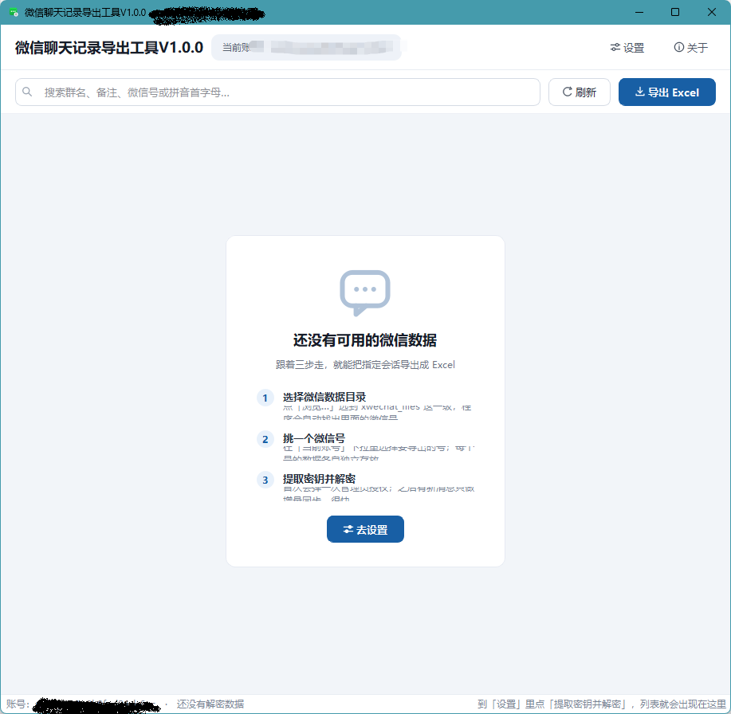
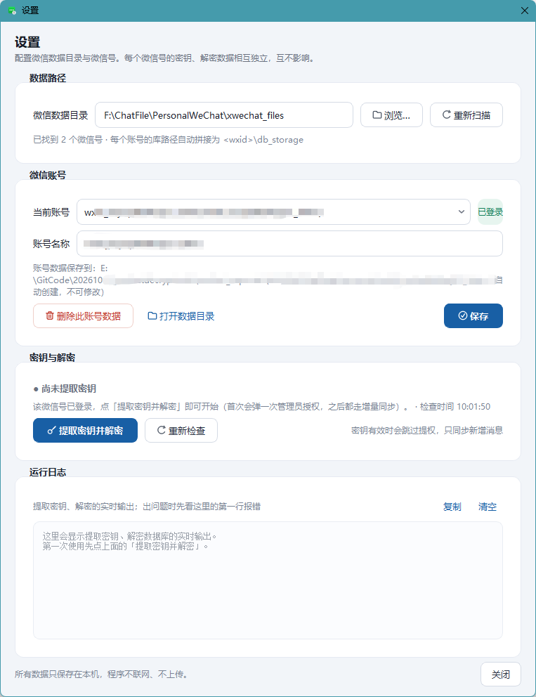
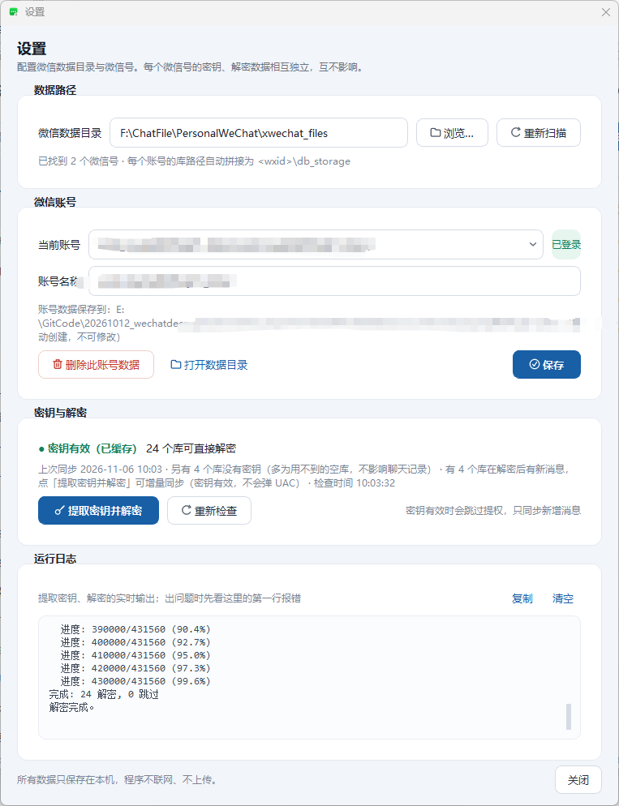
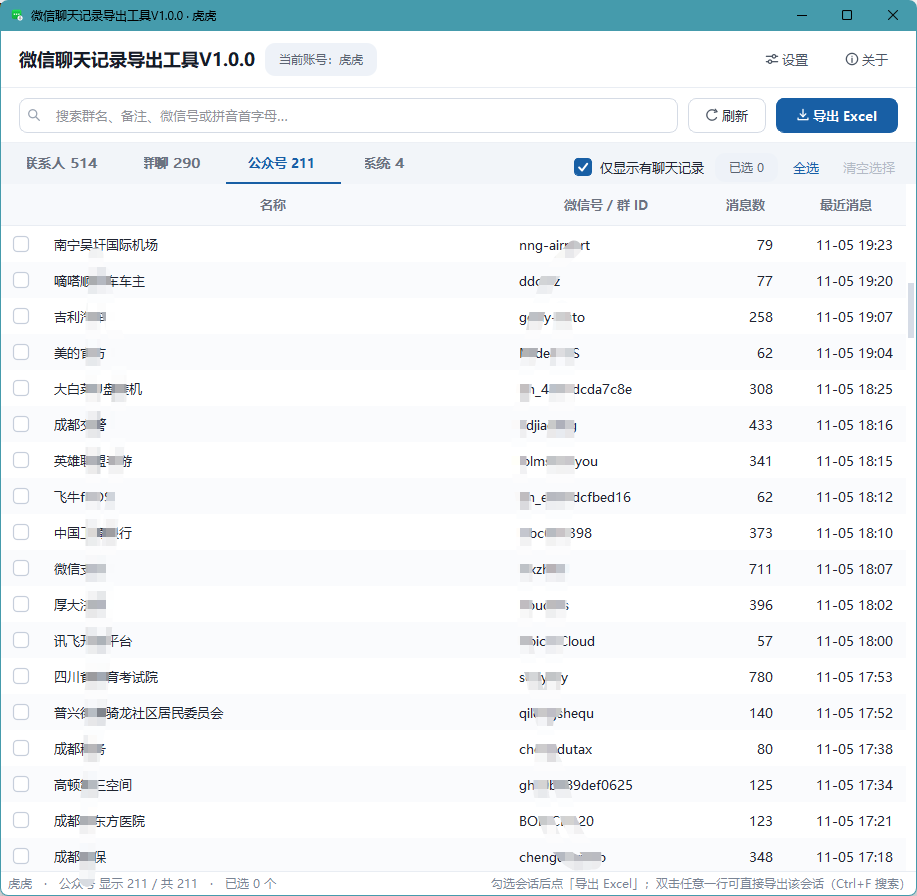
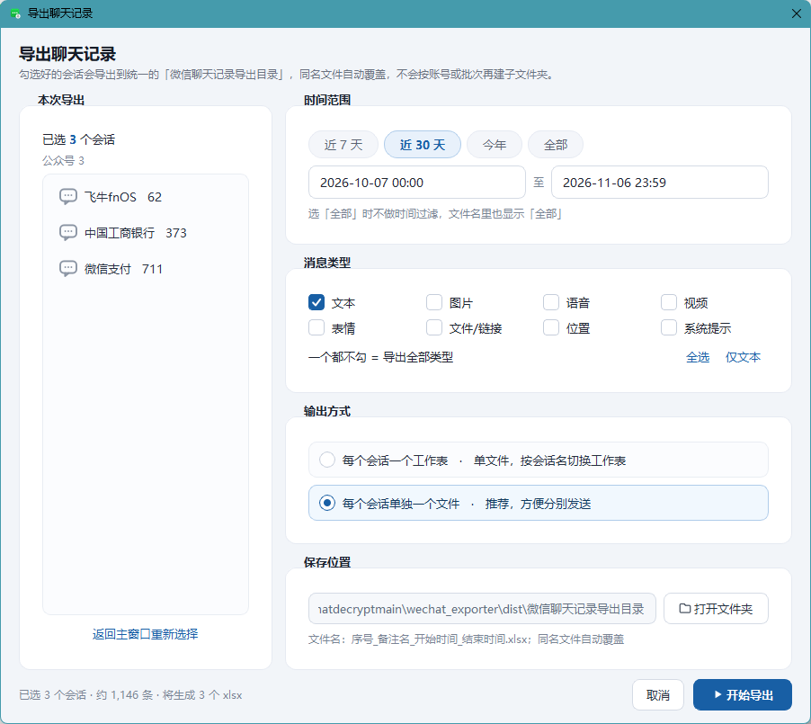

# 微信聊天记录导出

从本机微信 4.0（Windows）解密后的数据库里，按**会话**和**时间范围**把聊天记录导出成 Excel。
所有数据只在本机处理，程序不联网、不上传。

- 程序名：`微信聊天记录导出`
- 主程序入口：`main.py`
- 打包产物：`dist\微信聊天记录导出.exe`（单文件，约 53 MB）
- 微信4.0使用SQLCipher 4加密本地数据库：

    加密算法：AES-256-CBC + HMAC-SHA512
    KDF：PBKDF2-HMAC-SHA512，迭代次数 256,000 次
    页面大小：4096 字节，保留 = 80 (IV 16 + HMAC 64)
    每个数据库都有独立的 salt 和 enc_key
    WCDB (微信的 SQLCipher 封装) 会在进程内存中存储派生后的原始密钥，格式为x'<64hex_enc_key><32hex_salt>'。
- 本工具通过扫描进程内存中的这种模式，匹配数据库文件的盐，并通过 HMAC 验证来提取正确的密钥。

---

## 一、功能

| 能力 | 说明 |
|---|---|
| 多账号 | 一个微信号一套独立的密钥与解密数据，互不影响 |
| 多开识别 | 同时登录多个号时，按数据库 salt 命中数自动挑对微信进程 |
| 提取密钥 | 从运行中的 `Weixin.exe` 内存里扫出 SQLCipher 密钥（需管理员权限，会弹 UAC） |
| 增量解密 | 只重新解密有变化的库（按 mtime / size / salt 判断），日常几十秒 |
| 会话列表 | 联系人 / 群聊 / 公众号 / 系统 四个 Tab，支持搜索、全选、跨 Tab 勾选 |
| 按条件导出 | 时间范围（近 7 天 / 近 30 天 / 今年 / 全部 / 自定义）+ 消息类型过滤 |
| 两种输出 | 每个会话一个 xlsx；或一个 xlsx 里每个会话一张工作表 |
| 导出位置固定 | 一律落在 exe 同级的 `微信聊天记录导出目录`，不按账号或批次再建子文件夹 |

---

## 二、运行环境

- Windows 10 / 11（需要读取进程内存，仅支持 Windows）
- 微信 4.0 已登录（`Weixin.exe`）
- 跑源码：Python 3.10+（开发与打包用的是 3.12）
- 提取密钥时必须以**管理员身份**运行，否则读不了微信进程内存

依赖（`requirements.txt`）：

```
PyQt5>=5.15.9
openpyxl>=3.1
zstandard>=0.22
pycryptodome>=3.20
```

---

## 三、快速开始

1. 打开程序 → 右上角「设置」。
2. 「数据目录」选微信的 `xwechat_files` 目录（里面是 `wxid_` 开头的文件夹），程序会自动扫出账号。
3. 点「提取密钥并解密」，等日志出现 `完成: N 解密`（首次几分钟，之后是增量，几十秒）。
4. 回到主界面勾选会话 → 点「导出 Excel」→ 选时间范围、消息类型、输出方式 → 开始导出。
5. 导出完成后点「打开文件夹」，文件都在 `微信聊天记录导出目录` 里。





---

## 四、导出的 Excel 长什么样

每张工作表都按统一模板排版（模板文件：`聊天记录导出模板.xlsx`）：

| 行 | 内容 |
|---|---|
| 第 1 行 | `会话信息` |
| 第 2 行 | `微信ID` / 会话 username　　`昵称` / 会话显示名 |
| 第 3 行 | `导出工具` / 微信聊天记录导出　　`导出时间` / YYYY-MM-DD HH:MM:SS |
| 第 4 行 | 空行 |
| 第 5 行 | 表头：`序号` `时间` `发送者身份` `消息类型` `内容` `发送人ID` |
| 第 6 行起 | 消息数据，序号从 1 递增 |

列宽：序号 6 / 时间 20 / 发送者身份 18 / 消息类型 12 / 内容 60 / 发送人ID 26。
表头不加粗、不冻结、无底色边框，与模板保持一致。

**消息类型**写作：文本消息 / 图片消息 / 语音消息 / 视频消息 / 表情消息 / 位置消息 /
文件消息/链接消息 / 系统消息（名片等其他类型写「其他消息」）。

**两种输出方式**

| 方式 | 产物 | 适用 |
|---|---|---|
| 每个会话单独一个文件 | N 个 xlsx，文件名 `序号_备注名_时间范围.xlsx` | 分别发给别人 |
| 每个会话一个工作表 | 1 个 xlsx，文件名 `聊天记录_时间范围.xlsx`，每个会话一张表（无汇总页） | 自己归档、对照 |

说明：
- 时间范围写进文件名，如 `20261006_20261105`；选「全部」时写 `全部`。
- 同名文件直接覆盖，不生成 `(1)` 副本。
- 选定范围内没有消息的会话会跳过，不生成空文件。
- 单条内容超过 32000 字会被截断并补 `…`（Excel 单元格上限 32767）。

---

## 五、目录结构

### 源码

```
wechat_exporter/
  main.py                 程序入口（GUI 启动 / --bootstrap-* 子进程分派）
  app_config.py          路径与偏好（唯一的"路径真相来源"）
  build.py                一键打包脚本
  requirements.txt
  _bootstrap_keys.py      提权子进程：提取密钥（含多开时的进程挑选）
  _bootstrap_decrypt.py   子进程：批量解密数据库
  _diag_keys.py           诊断：密钥提取排查
  _diag_who.py            诊断：确认哪个微信进程在占用库
  assets/app_icon.ico
  core/                   业务层（不依赖 PyQt，可命令行单独跑）
    accounts.py             账号配置与各类文件路径
    contacts.py             联系人 / 群昵称 / 会话对象 / 缓存
    messages.py             跨分库扫消息、解压正文、解析发送人
    exporter.py             写 xlsx（两种模式，版面在这里定义）
    runner.py               调起子进程、读子进程日志
    detect.py               定位微信目录、判断库是否被占用
  ui/                     界面层（PyQt5）
    main_window.py          主窗口 + 加载/统计线程
    settings_dialog.py      设置窗（账号 / 密钥 / 解密 / 数据目录）
    export_dialog.py        导出参数弹窗
    export_runner.py        导出进度窗 + 后台导出线程
    table_model.py          会话列表数据模型
    delegates.py            勾选列自绘
    theme.py                全局 QSS
    icons.py                运行时绘制的线条图标与勾选贴图
```

### 运行时数据（都在 exe 同级，源码运行时在 `wechat_exporter/` 下）

```
WeChatData/accounts/<wxid>/
  account.json      账号配置（名称 / 微信数据目录）
  keys.json         密钥缓存
  manifest.json     增量解密清单（mtime/size/salt）
  counts.json       各会话消息数缓存
  sync.log / keys.log / decrypt.log
  db/               解密后的明文库（contact / message / session / bizchat ...）
微信聊天记录导出目录/   所有导出的 xlsx
```

exe 若放在 `Program Files` 这类无写权限的目录，数据会自动退化到
`%LOCALAPPDATA%\WeChatData`，程序仍可用。

---

## 六、打包

两种方式任选一种，产物都是 `dist\微信聊天记录导出.exe`。

### 方式一：跑打包脚本（推荐，最省事）

```cmd
cd /d E:\GitCode\20261012_wechatdecryptmain\wechat_exporter
C:\YuerHoo\Python31210\python.exe build.py
```

脚本里已经把参数、`--paths`、`--hidden-import` 全部写好，改需求时只动 `build.py`。

### 方式二：直接执行完整的 PyInstaller 命令

```cmd
cd /d E:\GitCode\20261012_wechatdecryptmain\wechat_exporter
C:\YuerHoo\Python31210\python.exe -m PyInstaller --noconfirm --clean --onefile --windowed --name 微信聊天记录导出 --icon E:\GitCode\20261012_wechatdecryptmain\wechat_exporter\assets\app_icon.ico --add-data "E:\GitCode\20261012_wechatdecryptmain\wechat_exporter\assets\app_icon.ico;assets" --add-data "E:\GitCode\20261012_wechatdecryptmain\wechat_exporter\_bootstrap_keys.py;." --add-data "E:\GitCode\20261012_wechatdecryptmain\wechat_exporter\_bootstrap_decrypt.py;." --paths E:\GitCode\20261012_wechatdecryptmain --hidden-import find_all_keys --hidden-import decrypt_db --hidden-import config --distpath E:\GitCode\20261012_wechatdecryptmain\wechat_exporter\dist --workpath E:\GitCode\20261012_wechatdecryptmain\wechat_exporter\build --specpath E:\GitCode\20261012_wechatdecryptmain\wechat_exporter\build E:\GitCode\20261012_wechatdecryptmain\wechat_exporter\main.py
```

参数要点：

| 参数 | 作用 |
|---|---|
| `--onefile` | 所有依赖压进一个 exe，运行时自解压到临时目录 |
| `--windowed` | GUI 程序，不带控制台窗口 |
| `--add-data "源;目标"` | Windows 上分隔符是**分号**；PowerShell 下必须给整个参数加双引号，否则分号会被当成命令分隔 |
| `--paths <仓库根>` | 不加的话 `find_all_keys` / `decrypt_db` / `config` 找不到，exe 一提密钥就 ImportError |
| `--hidden-import` ×3 | 这三个是运行时动态 import 的，静态分析看不到，必须显式声明 |

打包耗时约 1.5 分钟。`--clean` 会清构建缓存，所以每次都是全新产物。

---

## 七、常见问题

**提取密钥时提示 `0/20 salts`（一个都没匹配上）**
多半是同时登录了多个微信号：微信开了 8 个进程，脚本默认挑内存最大的那个，可能挑错了。
本程序已内置按 salt 命中数挑选进程的逻辑（`_bootstrap_keys.smart_get_pid`）；
若仍全部为 0，检查是否以管理员运行、是否登录的是要导出的那个号。

**主界面是空的 / 提示找不到库**
`WeChatData\accounts\<wxid>\db` 不存在或为空 —— 去设置里重新「提取密钥并解密」。

**设置里显示"待同步 N 个库"**
微信收到了新消息，点一次解密做增量同步即可，不需要重新提取密钥。

**解密能跑完但内容乱码**
密钥对但库版本不匹配（或库被其他程序写坏）。看 `decrypt.log` 里具体哪个库报错，
单独删掉该库对应的解密文件后重新同步。

**导出的 Excel 打不开 / 提示文件损坏**
导出采用"先写 `.tmp` 再原子替换"，中途取消不会留下半截文件。
若磁盘满了会保留 `.tmp`，删掉重导一次即可。

**杀毒软件报毒**
PyInstaller 单文件 + 读进程内存，容易被启发式误报。加信任即可，程序不联网。

---

## 八、隐私

- 全程只读本机磁盘与微信进程内存，不发起任何网络请求。
- 密钥、解密库、导出文件都留在本机 `WeChatData` / `微信聊天记录导出目录` 内。
- 导出的 Excel 是明文，请自行注意存放位置与分享范围。

---

## 九、开发约定

- 所有模块、类、函数都有中文 docstring，写清"为什么这么做"，而不只是"做了什么"。
- 界面层（`ui/`）不直接读写 sqlite；耗时操作一律放 `QThread`，用信号回主线程。
- 业务层（`core/`）不 import PyQt，保证可以脱离界面在命令行调试。
- 导出路径只有 `app_config.export_dir()` 一个出口，禁止在别处拼导出路径。
